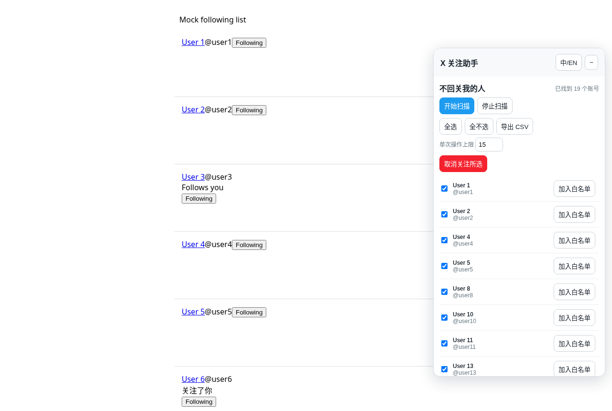
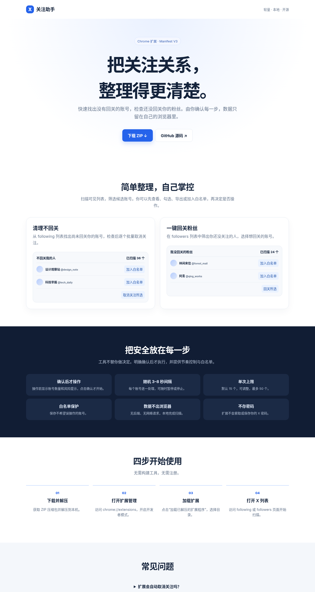

# X 关注助手 / X Follow Helper

## 中文

X 关注助手是一款开源 Chrome 扩展，帮助你检查 X 上的关注关系，并在确认后批量关注或取消关注。全部处理在浏览器本地完成。

### 功能

- 找出你关注但没有回关你的人，或你尚未回关的粉丝。
- 白名单、CSV 导出、单次操作数量上限、暂停和停止。
- 中文和英文界面。

### 安装

1. 下载 [ZIP](https://github.com/gaosen13-byte/x-follow-helper/archive/refs/heads/main.zip) 并解压。
2. 打开 `chrome://extensions`，开启“开发者模式”。
3. 点击“加载已解压的扩展程序”，选择解压后的目录。

### 使用

1. 登录 X，打开 `x.com/<你的用户名>/following` 或 `x.com/<你的用户名>/followers`。
2. 在页面右侧打开 X 关注助手并点击“开始扫描”。
3. 检查结果、勾选账号，按需加入白名单或导出 CSV。
4. 选择操作数量并点击操作按钮；核对确认对话框后才会开始。可随时暂停或停止。

### 安全说明

**X 会限制关注和取消关注的频率。请保持小批次（每批不超过 15 个），并分散到一天内操作。** 工具仅在你确认后替你点击页面按钮，并使用随机 3–8 秒间隔。扩展从不索取或存储密码，不发送网络请求；设置和白名单保存在 `chrome.storage.local`，扫描数据仅保留在当前浏览器页面中。

### 隐私

扩展没有后端、分析脚本或网络请求。账号扫描和过滤均在当前浏览器内存中完成。只有你主动导出的 CSV 会下载到本机。

### 限制

工具依赖 X 页面 DOM，X 更改界面后可能暂时失效。关注提示文字目前只识别英文和中文（“Follows you” / “关注了你”）。请先检查扫描结果再执行操作。

### 截图

| 扫描“不回关我的人” | 逐个执行中（进度 2 / 3） |
|---|---|
|  |  |

落地页：



> 截图来自 `test/` 中的本地模拟页面，真实 X 页面样式会不同。

作者 X：[@qingao1030](https://x.com/qingao1030)

## English

X Follow Helper is an open-source Chrome extension for reviewing follow relationships on X and taking actions only after confirmation. All processing stays in your browser.

### Features

- Find accounts you follow that do not follow you back, or followers you do not follow back.
- Whitelist, CSV export, per-run cap, pause, and stop controls.
- Chinese and English interface.

### Install

1. Download and extract the [ZIP archive](https://github.com/gaosen13-byte/x-follow-helper/archive/refs/heads/main.zip).
2. Open `chrome://extensions` and enable Developer mode.
3. Click **Load unpacked** and select the extracted directory.

### Use

1. Sign in to X and open `x.com/<your-handle>/following` or `x.com/<your-handle>/followers`.
2. Open the helper on the right and click **Scan list**.
3. Review results, select accounts, and optionally whitelist or export them.
4. Set the action limit and click the action button. Review the confirmation dialog before it starts. Pause or stop at any time.

### Safety

**X limits follow and unfollow volume. Keep batches small (15 or fewer) and spread them over the day.** The tool only clicks page buttons after you confirm and uses a random 3–8 second delay. It never asks for or stores passwords and makes no network requests. Settings and the whitelist live in `chrome.storage.local`; scanned data stays in the current browser page.

### Privacy

There is no backend, analytics, or network request. Scanning and filtering happen in browser memory. A CSV is downloaded locally only when you choose to export it.

### Limitations

The extension depends on X's DOM and may need updates when X changes its interface. Follow-badge text detection currently supports English and Chinese (“Follows you” / “关注了你”). Review scan results before taking action.

### Screenshots

See the screenshots in the Chinese section above (`docs/panel-following.png`, `docs/panel-running.png`, `docs/landing.png`). They were taken on the local mock pages in `test/`.

Author on X: [@qingao1030](https://x.com/qingao1030)

## 测试 / Tests

无需安装依赖，用 Chrome 打开即可（或无头模式）/ No dependencies; open in Chrome:

- `test/run-browser-test.html` — 扫描器解析、过滤、白名单、CSV / scanner parsing, filtering, whitelist, CSV
- `test/run-actions-test.html` — 模拟 X 页面上的滚动扫描、取消关注确认流程、上限、停止 / scroll-scan, unfollow confirm flow, cap, stop on a mock page

```bash
google-chrome --headless=new --allow-file-access-from-files --virtual-time-budget=60000 --dump-dom file://$PWD/test/run-actions-test.html | grep -o 'ALL PASS\|FAIL'
```
